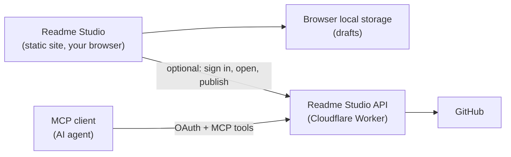

<div align="center">

# Readme Studio

**A browser-based visual editor for GitHub repository and profile READMEs.**

[](https://github.com/octacity-org/readme-studio/actions)
[](https://opensource.org/licenses/MIT)

[**Open Readme Studio**](https://octacity-org.github.io/readme-studio/) • [**Report a bug**](https://github.com/octacity-org/readme-studio/issues) • [**Request a feature**](https://github.com/octacity-org/readme-studio/issues)

</div>

Readme Studio lets you write a README visually or in plain Markdown, see it the way GitHub renders it, and add badges, profile widgets, a table of contents, and a project tree without memorizing their URLs.

Drafts stay in your browser. You only need a GitHub account if you want to open a README from a repository, load your real contribution graph, or publish back to GitHub. AI agents can use the same tools through an OAuth-protected MCP server.

## Contents

- [Try it](#try-it)
- [How it works](#how-it-works)
- [What you can do](#what-you-can-do)
- [Connect GitHub](#connect-github)
- [Use it from an AI agent (MCP)](#use-it-from-an-ai-agent-mcp)
- [Privacy](#privacy)
- [Run locally](#run-locally)
- [Current boundaries](#current-boundaries)
- [License](#license)

## Try it

Open **[octacity-org.github.io/readme-studio](https://octacity-org.github.io/readme-studio/)**. There is nothing to install and no account to create.

1. Start from the sample README, drop in an existing `.md` file, or open one from GitHub.
2. Edit in the visual editor, or switch to plain Markdown.
3. Pick a tool from the toolbox, such as **Badge** or **Tech stack**, and insert it where you want it.
4. Press **Export** (or `Cmd/Ctrl + S`) to download `README.md`, or publish it straight to a repository.

## How it works



The editor is a static SolidJS site hosted on GitHub Pages. Editing, previewing, importing, and exporting all happen in the browser.

The optional API is a Cloudflare Worker. It handles GitHub sign-in, reads and publishes READMEs, and serves the MCP endpoint for agents.

## What you can do

### Edit and check

| Feature | Details |
| --- | --- |
| Visual or plain editing | Edit rendered blocks directly, or switch to raw Markdown. |
| Slash commands | Type `/` in the visual editor to insert headings, lists, tables, code, quotes, dividers, and GitHub note callouts. |
| Tables | Add rows and columns, move between cells with `Tab`, and paste cells from a spreadsheet. |
| Block reordering | Drag blocks, or move them with `Alt + ↑/↓`. |
| GitHub-style preview | A full-width preview using GitHub Flavored Markdown, sanitized with DOMPurify. |
| README checks | Flags a missing H1 title, images without alt text, and duplicate headings. |
| Outline and stats | A clickable heading outline plus word, character, and line counts. |
| Import and export | Drop in or open a `.md` file and download `README.md`. Drafts autosave locally. |

Shortcuts: `Cmd/Ctrl + S` export, `Cmd/Ctrl + B` bold, `Cmd/Ctrl + K` link. The visual editor also supports `Cmd/Ctrl + I` italic and `Cmd/Ctrl + Z` / `Shift + Cmd/Ctrl + Z` undo and redo.

### Repository README tools

- **Shields.io badges:** live presets for build status, license, latest release, npm downloads, Codecov coverage, Read the Docs, Discord, and GitHub stars, plus a custom badge designer (label, message, color, style, logo, link).
- **Table of contents:** generated from your H2–H6 headings with GitHub-compatible anchor links.
- **Project tree:** paste one path per line and get a clean directory tree.
- **Inserts:** headings, links, images, code blocks, tables, collapsible `<details>` sections, and centered blocks.

### Profile README tools

| Tool | What it adds |
| --- | --- |
| Templates | Four starting points: minimal, visual, open source, and playful arcade. |
| Header / footer | Capsule Render banners. |
| Profile text and images | Headings, paragraphs, images, and GIFs, aligned left, center, or right. |
| Tech stack | Icon rows from Skill Icons, Devicons, Simple Icons, or Shields.io. |
| Social links | Icon links for 37 platforms. |
| GitHub stats | Stats, top languages, streak, trophy, and activity-graph cards. |
| Profile views | A visitor counter. |
| Medium articles | Your latest Medium posts. |
| Contribution snake | An animated snake that eats your contribution graph. |
| Arcade games | Pac-Man, Breakout, Galaga, Puzzle Bobble, and Bomberman contribution graphs. |

The snake and arcade animations are rendered by GitHub Actions in your profile repository. Readme Studio detects them in your README and generates the workflow files you need (`.github/workflows/snake.yml` and `.github/workflows/arcade.yml`). You can download those files, or have them published together with the README.

## Connect GitHub

Signing in with GitHub is optional. It enables three things:

- **Open from GitHub:** browse your repositories and load a README from a branch.
- **Real contribution data:** use your actual contribution calendar in the snake and arcade previews.
- **Publish to GitHub:** commit `README.md` and any generated workflow files to a branch in one commit.

Readme Studio signs in through a GitHub App. It can publish to a repository only when the app is installed on that repository with **Contents** write access (plus **Workflows** write access for workflow files) and your own account can push to it. Your browser receives an encrypted Readme Studio session that expires after 30 minutes. The page cannot read your GitHub token from it.

## Use it from an AI agent (MCP)

Readme Studio has a remote MCP server at:

```text
https://readme-studio.rappeland2005.workers.dev/mcp
```

Any MCP client that supports OAuth can connect. The client opens a consent page, you sign in with GitHub, and the client receives an access token that lasts eight hours. There are no refresh tokens, so after eight hours you sign in again.

For example, with Claude Code:

```bash
claude mcp add --transport http readme-studio https://readme-studio.rappeland2005.workers.dev/mcp
```

Then run `/mcp` in Claude Code to sign in.

| Tool | Purpose |
| --- | --- |
| `create_readme` | Create a concise README from a title, description, installation, usage, and license. |
| `analyze_readme` | Return statistics, heading structure, duplicate headings, and missing alt text. |
| `generate_toc` | Build a table of contents from H2–H6 headings. |
| `generate_project_tree` | Build a directory tree from a list of paths. |
| `generate_badge` | Create a custom or preset Shields.io badge. |
| `generate_profile_readme` | Create a profile README for the signed-in GitHub user. |
| `github_get_user` | Return the connected GitHub account. |
| `github_list_repositories` | List repositories the account can access. |
| `github_read_readme` | Read `README.md` from a repository branch. |
| `github_publish_readme` | Publish a README to a branch. Marked destructive and rate limited. |

Every tool requires sign-in, and generation, GitHub reads, and publishing each have their own per-user rate limit.

## Privacy

- Drafts are stored only in your browser's local storage.
- The optional API does not intentionally store README content. It keeps only short-lived OAuth codes and client registrations.
- The preview loads images from the services your README uses, such as Shields.io, Skill Icons, GitHub Readme Stats, and Capsule Render.

See the [privacy page](https://octacity-org.github.io/readme-studio/privacy/) for details.

## Run locally

Requirements: [Bun](https://bun.sh/) and Node.js 22.12 or newer.

```bash
git clone https://github.com/octacity-org/readme-studio.git
cd readme-studio
bun install
bun run dev
```

Open [http://localhost:3000/readme-studio/](http://localhost:3000/readme-studio/).

| Command | Description |
| --- | --- |
| `bun run dev` | Start the Vite development server. |
| `bun run build` | Build the static site into `dist/client`. |
| `bun run serve` | Preview the production build. |
| `bun run test` | Run the unit tests. |
| `bun run typecheck` | Type-check without emitting files. |

Every push to `main` runs the tests and type check, builds the site, and deploys it to GitHub Pages.

## Current boundaries

- Drafts live in one browser. There is no sync across devices and no collaborative editing.
- Snake and arcade animations only appear on GitHub after their workflows have run in your profile repository.
- Publishing commits directly to the branch you choose. It does not open a pull request.
- Agent access needs an MCP client with OAuth support. There is no unauthenticated API.

## License

Readme Studio is released under the MIT License.
